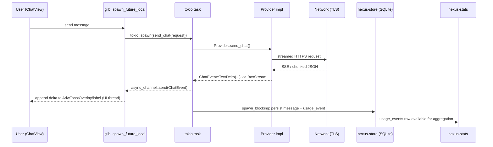
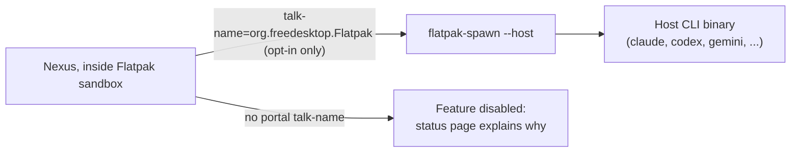

# Nexus — Architecture

Nexus is a Rust / GTK4 / libadwaita desktop application that unifies chat
access to multiple AI providers, local models, and command-line coding
agents, plus an automation engine and a local usage-statistics store.

## High-level component diagram

```mermaid
flowchart TB
    subgraph UI["Presentation layer (GTK4 + libadwaita + Blueprint)"]
        WIN[AdwApplicationWindow]
        CHAT[Chat view<br/>multi-model compare]
        AGENTS[CLI agent sessions<br/>VTE terminal / structured view]
        AUTOM[Automation editor &amp; runs]
        STATS[Statistics dashboard]
        PREFS[AdwPreferencesDialog<br/>accounts &amp; services]
    end

    subgraph CORE["nexus-core (shared contracts)"]
        PTRAIT["Provider trait<br/>list_models / send_chat / status"]
        CATRAIT["CliAgent trait<br/>detect / build_command"]
        TYPES[Chat &amp; model types,<br/>ProviderError]
    end

    subgraph PROV["nexus-providers"]
        OPENAI[OpenAI]
        ANTH[Anthropic]
        GEMINI[Google Gemini]
        OAICOMPAT["Generic OpenAI-compatible<br/>(Mistral, Groq, DeepSeek,<br/>OpenRouter, Together, Perplexity,<br/>xAI Grok, Qwen/DashScope, custom URL)"]
        COHERE[Cohere]
        AZURE[Azure OpenAI]
        BEDROCK["Amazon Bedrock (stub)"]
        LOCAL["Local: Ollama, LM Studio,<br/>llama.cpp server"]
        DISCOVERY[LAN/localhost discovery]
    end

    subgraph CLIAG["nexus-cli-agents"]
        DETECT["Detector<br/>PATH scan + version probe"]
        RUNNER["CommandRunner trait<br/>direct exec OR<br/>flatpak-spawn --host"]
        CLIS["Claude Code, Codex CLI, Gemini CLI,<br/>Qwen Code, cursor-agent, Windsurf,<br/>Antigravity (agy), Aider, GitHub Copilot CLI,<br/>user-defined generic CLI"]
    end

    subgraph AUTO["nexus-automation"]
        ENGINE[Step engine:<br/>prompt / CLI / transform /<br/>condition / notify / write-file]
        TRIGGERS["Triggers: manual, cron-like schedule,<br/>folder-watch"]
        RUNLOG[Run log]
    end

    subgraph STATSM["nexus-stats"]
        AGG[Aggregation queries]
        PRICING["pricing.toml<br/>(hand-maintained, never invented)"]
    end

    subgraph STORE["nexus-store (SQLite via rusqlite)"]
        DB[(nexus.db<br/>conversations, messages,<br/>automations, runs, usage_events)]
    end

    subgraph SEC["nexus-secrets"]
        OO7["oo7 crate<br/>Secret Service / Secret portal"]
    end

    WIN --> CHAT & AGENTS & AUTOM & STATS & PREFS
    CHAT --> PTRAIT
    PREFS --> PTRAIT & CATRAIT & SEC
    AGENTS --> CATRAIT
    AUTOM --> ENGINE
    ENGINE --> PTRAIT & CATRAIT
    ENGINE --> RUNLOG --> DB
    STATS --> AGG --> DB
    AGG --> PRICING
    CHAT --> DB
    PTRAIT -.implemented by.-> OPENAI & ANTH & GEMINI & OAICOMPAT & COHERE & AZURE & BEDROCK & LOCAL
    CATRAIT -.implemented by.-> CLIS
    CLIS --> RUNNER
    PROV --> SEC
    PROV --> TYPES
    CLIAG --> TYPES
    DISCOVERY --> LOCAL
```

## Async execution model

Nexus uses **tokio** (multi-thread runtime, started once in `main.rs`) for
all I/O: HTTP streaming to providers (`reqwest` + `rustls`), spawning CLI
subprocesses (`tokio::process::Command`, or `flatpak-spawn --host` when
sandboxed), and blocking SQLite access (`rusqlite` is synchronous, so every
call goes through `tokio::task::spawn_blocking`).

GTK4's main loop (`glib::MainContext`) is **not** thread-safe: widgets may
only be touched from the thread that owns the default main context. We
therefore never block that thread and never touch widgets from a tokio
worker thread. The bridge is:

- UI-triggered actions call `glib::spawn_future_local(async move { ... })`
  on the GLib main context. Inside that future we `.await` an
  `async_channel::Receiver` fed by a tokio task, or directly `.await` a
  `tokio::spawn`-ed `JoinHandle` (tokio's `spawn` can be called from any
  thread once the runtime is running; we keep a `tokio::runtime::Handle`
  in application state for this).
- Long-running streams (chat token deltas, CLI stdout/stderr) are pushed
  through an `async_channel` (bounded, backpressured) from the tokio task
  into a `glib::spawn_future_local` loop that updates widgets per message.

This is the same pattern used by GNOME applications such as Fractal and
Shortwave: a single process-wide tokio runtime for I/O, GLib futures for
anything that touches widgets, and channels as the only crossing point.
We do **not** use `async-std` or a bespoke GLib-only HTTP stack, because
`reqwest`+`rustls` is the maintained, sandboxed-friendly TLS stack already
required by the spec, and it is a tokio-native crate.

## Data flow for a chat request

## CLI agent sandbox boundary

See `docs/FLATPAK_PERMISSIONS.md` for the exact justification given to
Flathub reviewers and the degraded behaviour when the permission is
refused.

## Crate layout

| Crate | Responsibility |
|---|---|
| `nexus-core` | `Provider` and `CliAgent` traits, shared chat/model/error types, `SecretStore` trait, URL validation, shared `reqwest::Client` builder (rustls, TLS enforced). No GTK dependency — unit-testable in isolation. |
| `nexus-secrets` | `SecretStore` implementation backed by the `oo7` crate (Secret Service / `org.freedesktop.portal.Secret`). |
| `nexus-store` | SQLite schema + typed repositories (conversations, messages, automations, runs, usage events, settings) via `rusqlite`. |
| `nexus-providers` | One module per provider implementing `Provider`. |
| `nexus-cli-agents` | `CommandRunner` (direct vs. `flatpak-spawn --host`), CLI detector, one module per agent implementing `CliAgent`. |
| `nexus-automation` | Step engine, trigger scheduler, run log. |
| `nexus-stats` | Aggregation queries over `usage_events`, pricing table loader. |
| `src/` (binary `nexus`) | GTK4/libadwaita application, Blueprint-defined UI, wires the crates above together. |

## Known limitations

See `docs/LIMITATIONS.md` for the authoritative, up-to-date list (CLI
flags that could not be verified, providers shipped as documented stubs,
Bedrock's SigV4 complexity, etc.). Nothing in this document should be
taken as proof that an API or flag exists beyond what `docs/LIMITATIONS.md`
and inline `// VERIFIED:` / `// UNVERIFIED:` comments state.
